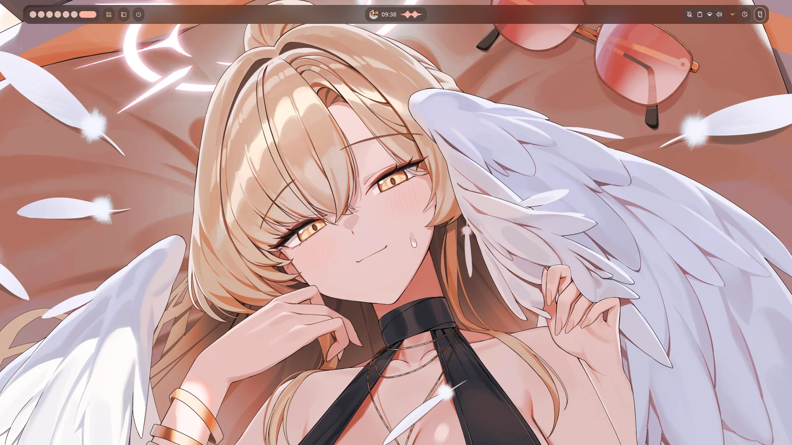
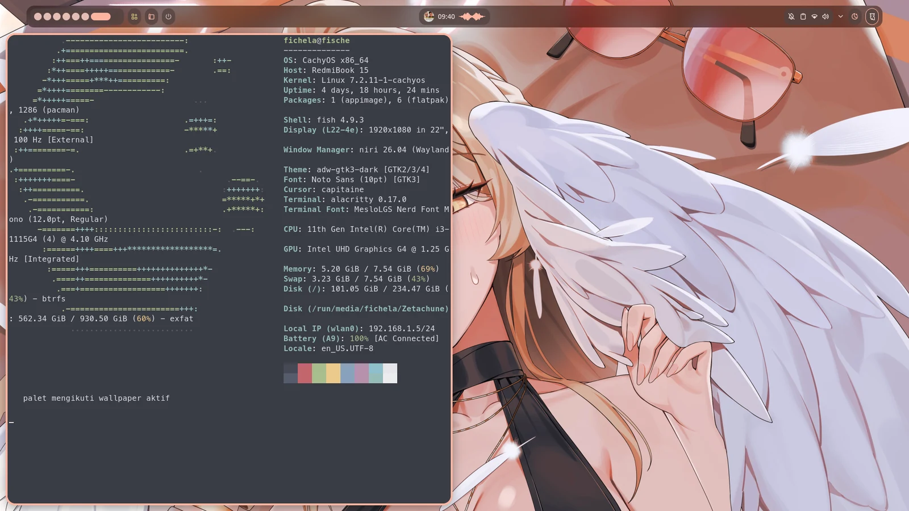
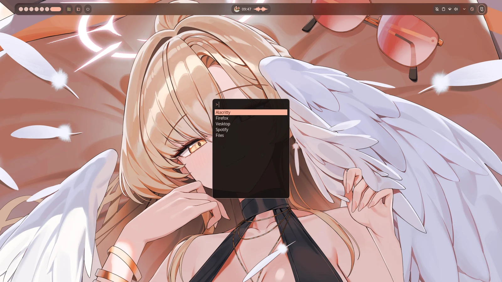
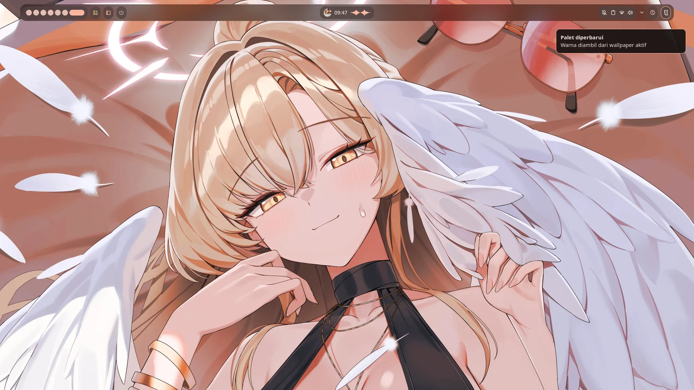
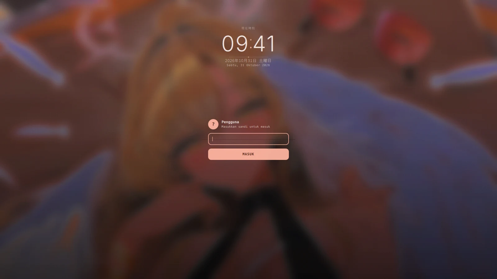

# rice — CachyOS · niri · Noctalia

Dotfiles untuk **CachyOS** dengan compositor **niri** dan shell **Noctalia**, memakai
**satu sumber warna**: palet Material 3 yang diturunkan dari wallpaper aktif.
Ganti wallpaper → bar, terminal, launcher, notifikasi, lock screen, sampai layar login
ikut berubah warna.

<p align="center">
  
</p>

---

## Tampilan

### Terminal — palet ikut wallpaper

Alacritty dengan MesloLGS Nerd Font Mono, opacity ditangani niri (bukan terminal),
warna 16 ANSI di-render dari palet yang sama dengan bar.

<p align="center">
  
</p>

### Launcher — fuzzel

Warna, radius, dan font mengikuti template Noctalia (bukan config statis).

<p align="center">
  
</p>

### Notifikasi — mako

Border dan aksen dari palet aktif, radius sama dengan elemen lain (16).

<p align="center">
  
</p>

### Layar login — SDDM kustom

Tema QML buatan sendiri: jam besar dengan font retro **DotGothic16**, kanji「現在時刻」,
tanggal Jepang + Indonesia, kartu login tipis dengan aksen vertikal, kolom sandi
dengan tombol reveal, selector sesi/layout, dan tombol daya.
Background = wallpaper aktif yang di-blur + digelapkan, warna dari palet yang sama.

<p align="center">
  
</p>

---

## Cara kerja warna

```
  ~/Pictures/Wallpaper/*.jpg
          │
          │  noctalia-palette
          ▼
  ~/.config/noctalia/palettes/Wallpaper.json        (Material 3, skema m3-content, dark)
          │
          │  noctalia msg templates-apply
          ▼
  ┌────────────────────────────────────────────────────────────┐
  │ gtk3 · gtk4 · qt5ct/qt6ct · alacritty · niri · mako        │
  │ fuzzel · swaylock · vesktop                                │
  └────────────────────────────────────────────────────────────┘
          │
          │  sddm-theme-sync   (blur + dim wallpaper, render theme.conf)
          ▼
  /var/lib/noctalia-greeter/themes/noctalia/        → layar login
```

Karena `$HOME` bermode `700` dan user `sddm` tidak bisa membacanya, background login
di-**bake** ke `/var/lib/noctalia-greeter/` (world-readable), bukan dibaca langsung.

---

## Instalasi otomatis

### Satu perintah

```bash
git clone <url-repo> ~/.dotfiles
cd ~/.dotfiles
./install.sh
```

`install.sh` menjalankan 7 tahap berurutan, dan berhenti kalau ada yang gagal:

| Tahap | Isi |
|---|---|
| 1 | cek prasyarat (bukan root, Arch-based, pacman, struktur repo) |
| 2 | pasang paket repo resmi (`packages/rice.txt`) |
| 3 | pasang paket AUR kalau `paru`/`yay` ada (`packages/aur.txt`) |
| 4 | salin dotfiles ke `$HOME` (backup otomatis) |
| 5 | pengaturan sistem via sudo (SDDM, mask indexer, gsettings) |
| 6 | bangun palette dari wallpaper + render semua template |
| 7 | verifikasi (config, palette, font, tema SDDM, skrip executable) |

Opsi:

```bash
./install.sh --dry-run      # simulasi, tidak mengubah apa pun
./install.sh --link         # symlink ke repo (enak buat ngedit dotfiles)
./install.sh --no-packages  # mesin sudah lengkap, lewati pacman
./install.sh --no-system    # lewati langkah sudo
./install.sh --yes          # tanpa konfirmasi interaktif
```

### Kalau mau manual, per bagian

```bash
./packages/install-packages.sh   # paket saja
./bootstrap.sh                   # dotfiles saja (--link / --copy / --dry-run)
./system/setup-system.sh         # pengaturan sistem saja (sudo)
noctalia-palette                 # palette saja
```

### Setelah instalasi

1. Taruh minimal satu gambar di `~/Pictures/Wallpaper/`
2. `wallpaper-rotate` (atau `wallpaper-rotate --next`)
3. Logout / reboot

Tes layar login tanpa reboot:

```bash
timeout 8 sddm-greeter --test-mode --theme /var/lib/noctalia-greeter/themes/noctalia
```

---

## Skrip

| Skrip | Fungsi |
|---|---|
| `noctalia-palette` | turunkan palet Material dari wallpaper aktif, render semua template |
| `wallpaper-rotate` | ganti wallpaper (`--next`/`--prev`/`--random`) + palette + lock screen + background login |
| `sddm-theme-sync` | sinkron tema SDDM (background blur + `theme.conf` dari palet) |
| `mem-mode` | `hemat` / `penuh` / `status` — mode memori |
| `wallpaper-picker` | pilih wallpaper lewat fuzzel |
| `cliphist-fuzzel` | riwayat clipboard lewat fuzzel |

## Keybind penting

| Keybind | Aksi |
|---|---|
| `Mod+Space` | launcher (fuzzel) |
| `Mod+Shift+M` | mode hemat memori |
| `Mod+Ctrl+M` | status memori |
| `Mod+Shift+L` | lock screen |

---

## Struktur repo

```
.
├── install.sh                  # instalasi otomatis penuh
├── bootstrap.sh                # pasang file $HOME
├── packages/
│   ├── rice.txt                # paket minimal rice
│   ├── aur.txt                 # paket AUR
│   ├── explicit.txt            # semua paket mesin lama (referensi)
│   └── install-packages.sh
├── system/
│   ├── setup-system.sh         # SDDM, mask indexer, gsettings (sudo)
│   └── sddm.conf.d/20-theme.conf
├── home/
│   ├── .config/                # niri, noctalia, alacritty, fuzzel, mako,
│   │                           # swaylock, gtk3/4, qt5/6, fish, Altus, btop
│   ├── .local/bin/             # skrip rice
│   └── .local/share/noctalia-greeter/theme/   # tema SDDM + font + OFL
├── docs/
│   ├── CHANGES.md              # catatan perubahan di mesin lama
│   └── screenshots/
└── README.md
```

---

## Catatan teknis

- **Font**: `MesloLGS Nerd Font Mono` dari paket `ttf-meslo-nerd`;
  `DotGothic16` di-bundle di folder tema dan dimuat via `FontLoader` QML —
  tidak perlu di-install ke sistem.
- **SDDM**: tema di `/var/lib/noctalia-greeter/themes/noctalia`, didaftarkan lewat
  `/etc/sddm.conf.d/20-theme.conf`. Direktori dimiliki user (bukan root) supaya
  wallpaper bisa diganti tanpa sudo.
- **Hemat RAM (8 GB)**: `localsearch-3.service` di-mask, AnyDesk autostart dimatikan,
  zram zstd + systemd-oomd aktif.
- **Close-to-tray**: Altus (`closeToTray`, `trayIcon`) dan Vesktop.
- **Backup**: bootstrap menyimpan config lama di `~/.dotfiles-backup/<timestamp>/`.

## Lisensi

Config dan skrip: bebas dipakai (MIT).
Font **DotGothic16**: SIL Open Font License 1.1 — lihat
`home/.local/share/noctalia-greeter/theme/OFL.txt`.
